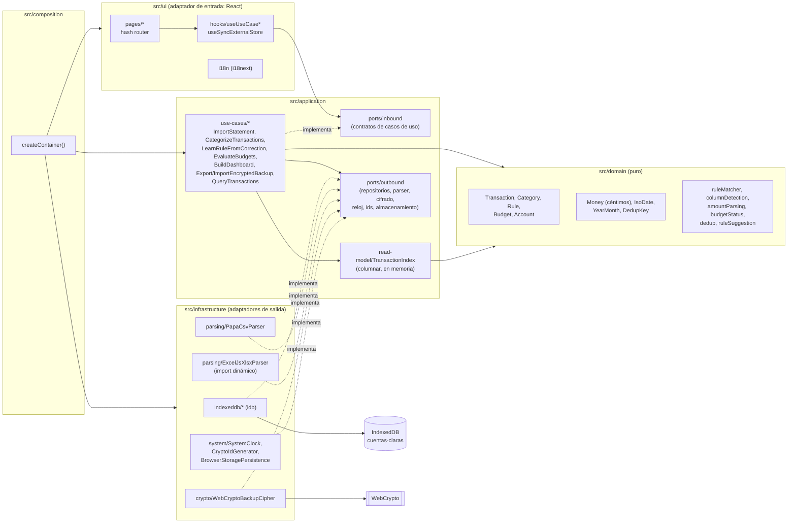
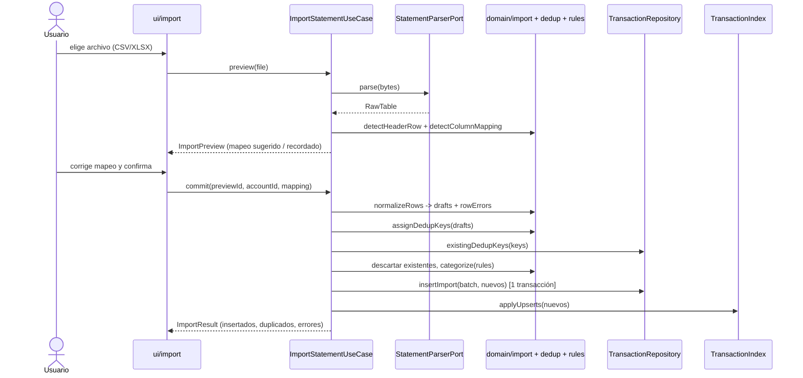

# Arquitectura de Cuentas Claras

> Documento de diseño elaborado con el rol `architect` de ECC, aplicando las skills
> `hexagonal-architecture` y `architecture-decision-records`.
> Fuentes: [`docs/BRIEF.md`](BRIEF.md) y `.claude/prds/cuentas-claras.prd.md`.
> Decisiones con alternativas y consecuencias: [`docs/adr/`](adr/README.md).
> Estado: **propuesta** (2026-11-17). Nada de lo descrito está implementado todavía.

## 1. Análisis del estado actual

- El repositorio solo contiene `package.json` con dependencias fijadas, el brief y el PRD. No hay `src/`.
- Versiones y librerías fijadas por el brief: React 19, TypeScript strict, Vite 8, idb, papaparse,
  exceljs, recharts, i18next, react-router-dom, vite-plugin-pwa, Vitest, Playwright, tinybench.
  **No hay** librería de estado global, de virtualización ni de consultas: el diseño se ajusta a ello.
- No hay deuda técnica previa: es la oportunidad de fijar las fronteras antes de escribir código.

## 2. Requisitos que condicionan la arquitectura

| Requisito | Fuente | Consecuencia arquitectónica |
|---|---|---|
| Sin backend, todo en el dispositivo | Brief | Persistencia y cifrado son adaptadores locales (IndexedDB, WebCrypto) |
| 100.000 movimientos, filtro < 200 ms | Brief + PRD | Índice en memoria columnar + lista virtualizada + IndexedDB con índices compuestos |
| Importar 1 año (~1.500 movs.) < 2 s | PRD | Parseo por lotes, dedup con un único índice único, escritura en una sola transacción IDB |
| Formatos bancarios españoles variables | Brief | Detección de columnas pura (dominio) + vista previa con corrección manual |
| Reimportar sin duplicados | Brief | Clave de deduplicación determinista con contador de ocurrencias |
| Copia cifrada con contraseña | Brief | Puerto de cifrado; AES-GCM 256 + PBKDF2-SHA-256 |
| ES/EN, WCAG 2.2 AA, offline, claro/oscuro | Brief | i18n en el borde UI; dominio devuelve códigos, no textos; PWA |
| Código en inglés, documentación y UI en español | Brief | Identificadores en inglés en todo `src/` |

Objetivos no funcionales (verificables en CI con tinybench y Playwright, Pixel 7, CPU ×4):

- Hidratación del índice en memoria con 100k movimientos: p95 < 1,5 s.
- Filtro/búsqueda sobre 100k: p95 < 200 ms (objetivo interno < 50 ms en desktop).
- Panel (agregados de 24 meses): < 100 ms sobre el índice.
- Scroll de lista: sin tareas largas > 50 ms durante el desplazamiento.

## 3. Visión general (Ports & Adapters)



Reglas de dependencia (verificadas con `no-restricted-imports` de ESLint por carpeta):

| Capa | Puede importar | No puede importar |
|---|---|---|
| `src/domain` | solo `src/domain` | React, idb, papaparse, exceljs, i18next, APIs del navegador (`indexedDB`, `crypto`, `Date.now`) |
| `src/application` | `src/domain`, `src/application` | `src/infrastructure`, `src/ui`, cualquier librería externa |
| `src/infrastructure` | `src/domain`, `src/application/ports` | `src/ui` |
| `src/ui` | `src/domain` (tipos y formateadores puros), `src/application/ports/inbound`, DTOs | `src/infrastructure`, `use-cases/*` concretos |
| `src/composition` | todo | — (único sitio que conoce adaptadores concretos) |

Detalle en [ADR-0001](adr/0001-arquitectura-hexagonal.md).

## 4. Estructura de carpetas y archivos

```text
src/
  main.tsx                         # arranque: createContainer() + <App/>; registro del SW
  composition/
    createContainer.ts             # composition root: instancia adaptadores e inyecta en casos de uso
    container.types.ts             # tipo AppContainer (solo puertos de entrada)
  domain/
    shared/
      Result.ts                    # Result<T, E> = Ok | Err (errores esperados sin excepciones)
      DomainError.ts               # códigos de error estables (claves i18n en la UI)
      brand.ts                     # Brand<T, Name>
      normalizeText.ts             # mayúsculas, sin tildes (NFD), espacios colapsados
    money/
      Money.ts                     # VO en céntimos enteros
      parseSpanishAmount.ts        # "1.234,56" | "-12,30" | "12,30-" -> Money (sin parseFloat)
    date/
      IsoDate.ts                   # 'YYYY-MM-DD' marcado; días desde epoch para el índice
      YearMonth.ts                 # 'YYYY-MM'
      parseSpanishDate.ts          # dd/mm/aaaa, dd-mm-aa, aaaa-mm-dd
    account/Account.ts
    category/
      Category.ts
      defaultCategories.ts         # conjunto inicial editable (ids estables, nombres vía i18n)
    transaction/
      Transaction.ts               # entidad + funciones puras (recategorize, withNote...)
      DedupKey.ts                  # clave determinista + asignación de ocurrencias
    rule/
      Rule.ts
      ruleMatcher.ts               # primera regla por prioridad; nunca pisa categoría manual
      ruleSuggestion.ts            # propone patrón a partir de un concepto corregido
    budget/
      Budget.ts
      budgetStatus.ts              # ok / near / over en enteros (puntos básicos)
    import/
      RawTable.ts                  # celdas crudas independientes del formato
      ColumnMapping.ts
      detectHeaderRow.ts
      detectColumnMapping.ts       # sinónimos ES/EN, puntuación por columna
      normalizeRows.ts             # RawTable + mapping -> TransactionDraft[] + errores por fila
  application/
    ports/
      inbound/                     # un contrato por caso de uso (lo que la UI ve)
        ImportStatement.ts
        CategorizeTransactions.ts
        LearnRuleFromCorrection.ts
        EvaluateBudgets.ts
        BuildDashboard.ts
        ExportEncryptedBackup.ts
        ImportEncryptedBackup.ts
        QueryTransactions.ts
        ManageCatalog.ts           # CRUD de cuentas, categorías, reglas y presupuestos
      outbound/
        TransactionRepository.ts
        CatalogRepositories.ts     # Account/Category/Rule/Budget repositories
        ImportBatchRepository.ts
        ImportProfileRepository.ts
        DataSnapshotPort.ts        # exportar/reemplazar todo de forma atómica
        StatementParserPort.ts
        BackupCipherPort.ts
        ClockPort.ts
        IdGeneratorPort.ts
        StoragePersistencePort.ts
    use-cases/
      ImportStatementUseCase.ts
      CategorizeTransactionsUseCase.ts
      LearnRuleFromCorrectionUseCase.ts
      EvaluateBudgetsUseCase.ts
      BuildDashboardUseCase.ts
      ExportEncryptedBackupUseCase.ts
      ImportEncryptedBackupUseCase.ts
      QueryTransactionsUseCase.ts
      ManageCatalogUseCase.ts
    read-model/
      TransactionIndex.ts          # índice columnar en memoria (TypedArrays)
      TransactionIndexStore.ts     # versión + suscripción (para useSyncExternalStore)
    backup/
      BackupSnapshot.ts            # DTO versionado de la copia
      migrateSnapshot.ts           # migraciones de formato de copia
  infrastructure/
    indexeddb/
      schema.ts                    # nombre, versión, stores, índices (tipado DBSchema de idb)
      openDatabase.ts              # openDB + upgrade por versiones
      mappers.ts                   # entidad <-> registro persistido
      IdbTransactionRepository.ts
      IdbCatalogRepositories.ts
      IdbImportBatchRepository.ts
      IdbImportProfileRepository.ts
      IdbDataSnapshot.ts
    parsing/
      decodeText.ts                # UTF-8 estricto con BOM; si falla, windows-1252
      PapaCsvParser.ts
      ExcelJsXlsxParser.ts         # import() dinámico de exceljs (chunk aparte)
      CompositeStatementParser.ts  # elige parser por extensión / firma de bytes
    crypto/
      WebCryptoBackupCipher.ts
      backupEnvelope.ts            # formato binario: magic + cabecera JSON + ciphertext
    system/
      SystemClock.ts
      CryptoIdGenerator.ts         # crypto.randomUUID()
      BrowserStoragePersistence.ts # navigator.storage.persist()/estimate()
  ui/
    App.tsx
    router.tsx                     # createHashRouter, rutas con lazy()
    container/ContainerContext.tsx # provee AppContainer (puertos de entrada)
    hooks/
      useContainer.ts
      useAsyncQuery.ts             # caché por clave + versión de datos
      useDataVersion.ts            # useSyncExternalStore sobre TransactionIndexStore
      useVirtualRows.ts            # virtualización de filas de altura fija (ADR-0008)
    i18n/
      i18n.ts                      # init i18next; es por defecto, en lazy
      locales/es/{common,import,transactions,budgets,dashboard,backup,errors}.json
      locales/en/...
      format.ts                    # Intl.NumberFormat / DateTimeFormat por locale
    theme/
      tokens.css                   # variables claro/oscuro, prefers-color-scheme
      ThemeProvider.tsx
    components/                    # Button, Dialog, Field, MoneyText, StatusBadge, DataTable...
    features/
      import/      ImportPage.tsx, ColumnMappingEditor.tsx, ImportPreviewTable.tsx
      transactions/TransactionsPage.tsx, TransactionFilters.tsx, VirtualTransactionList.tsx,
                   EditTransactionDialog.tsx, RuleSuggestionDialog.tsx
      categories/  CategoriesPage.tsx
      rules/       RulesPage.tsx
      budgets/     BudgetsPage.tsx
      dashboard/   DashboardPage.tsx, charts/*.tsx (recharts, lazy)
      settings/    SettingsPage.tsx, BackupSection.tsx
test/
  fakes/                           # implementaciones en memoria de puertos de salida
  contracts/                       # suites de contrato por puerto (fake y adaptador real)
  fixtures/                        # extractos de ejemplo (CSV ;, coma decimal, cp1252, XLSX)
  factories/                       # builders de entidades y generador de 100k movimientos
bench/                             # tinybench: índice, dedup, parseo
e2e/                               # Playwright (Pixel 7) + axe
```

Las rutas (hash router, [ADR-0005](adr/0005-estado-ui-sin-libreria.md)):
`#/` panel · `#/transactions` · `#/import` · `#/categories` · `#/rules` · `#/budgets` · `#/settings`.
Los filtros de la lista viven en la query del hash (`#/transactions?q=mercadona&cat=groceries&from=2026-01`),
de modo que son enlazables y sobreviven a recargas.

## 5. Modelo de dominio

### 5.1 Value objects

```ts
// domain/shared/brand.ts
export type Brand<T, Name extends string> = T & { readonly __brand: Name };

// domain/money/Money.ts — ADR-0003
export type Cents = Brand<number, 'Cents'>;              // entero seguro, con signo
export interface Money { readonly cents: Cents }          // moneda única EUR (PRD)
export const Money: {
  ofCents(cents: number): Result<Money, DomainError>;      // rechaza no enteros / fuera de safe integer
  zero(): Money;
  add(a: Money, b: Money): Money;
  subtract(a: Money, b: Money): Money;
  negate(a: Money): Money;
  sum(values: readonly Money[]): Money;
  isExpense(a: Money): boolean;                            // cents < 0
  compare(a: Money, b: Money): -1 | 0 | 1;
  ratioBasisPoints(part: Money, whole: Money): number;     // entero, 10000 = 100 %
};
export function parseSpanishAmount(text: string): Result<Money, DomainError>;

// domain/date/IsoDate.ts
export type IsoDate = Brand<string, 'IsoDate'>;           // 'YYYY-MM-DD', calendario sin zona horaria
export type YearMonth = Brand<string, 'YearMonth'>;       // 'YYYY-MM'
export const IsoDate: {
  parse(text: string): Result<IsoDate, DomainError>;       // valida fecha real (30/02 falla)
  toYearMonth(d: IsoDate): YearMonth;
  toEpochDay(d: IsoDate): number;                          // para Int32Array del índice
  fromEpochDay(n: number): IsoDate;
  compare(a: IsoDate, b: IsoDate): -1 | 0 | 1;             // comparación lexicográfica
};
export function parseSpanishDate(text: string): Result<IsoDate, DomainError>; // dd/mm siempre
```

### 5.2 Entidades

Todas son tipos `readonly`; las "mutaciones" son funciones puras que devuelven una copia nueva.

```ts
export type AccountId = Brand<string, 'AccountId'>;
export type CategoryId = Brand<string, 'CategoryId'>;
export type RuleId = Brand<string, 'RuleId'>;
export type BudgetId = Brand<string, 'BudgetId'>;
export type TransactionId = Brand<string, 'TransactionId'>;
export type ImportBatchId = Brand<string, 'ImportBatchId'>;

export const UNCATEGORIZED: CategoryId; // '__uncategorized__' — evita null (IndexedDB no indexa null)

export interface Account {
  readonly id: AccountId;
  readonly name: string;
  readonly ibanLast4: string | null;      // nunca se guarda el IBAN completo
  readonly currency: 'EUR';
  readonly createdAt: string;             // ISO datetime
}

export type CategoryKind = 'expense' | 'income' | 'transfer';
export interface Category {
  readonly id: CategoryId;
  readonly name: string;                  // editable; las por defecto usan nameKey i18n hasta que se editen
  readonly nameKey: string | null;
  readonly kind: CategoryKind;
  readonly color: string;                 // token de paleta, no hex libre
  readonly archived: boolean;
}

export type CategorySource = 'none' | 'rule' | 'manual';
export interface Transaction {
  readonly id: TransactionId;
  readonly accountId: AccountId;
  readonly date: IsoDate;                 // fecha de operación
  readonly valueDate: IsoDate | null;
  readonly amount: Money;                 // negativo = gasto
  readonly balance: Money | null;         // "Saldo" del extracto, si existe
  readonly rawDescription: string;        // inmutable, tal cual del banco
  readonly description: string;           // editable por el usuario
  readonly normalizedDescription: string; // normalizeText(rawDescription), base de reglas y búsqueda
  readonly categoryId: CategoryId;
  readonly categorySource: CategorySource;
  readonly ruleId: RuleId | null;
  readonly note: string;
  readonly dedupKey: DedupKey;
  readonly importBatchId: ImportBatchId;
  readonly createdAt: string;
  readonly updatedAt: string;
}

export type RuleOperator = 'contains' | 'startsWith' | 'equals'; // sin regex en v1 (ReDoS, ADR-0001)
export interface Rule {
  readonly id: RuleId;
  readonly pattern: string;               // normalizado
  readonly operator: RuleOperator;
  readonly amountSign: 'any' | 'expense' | 'income';
  readonly accountId: AccountId | null;   // null = todas las cuentas
  readonly categoryId: CategoryId;
  readonly priority: number;              // menor = antes; empates por createdAt
  readonly enabled: boolean;
  readonly origin: 'manual' | 'learned';
  readonly createdAt: string;
}

export interface Budget {
  readonly id: BudgetId;
  readonly categoryId: CategoryId;        // un presupuesto activo por categoría
  readonly monthlyLimit: Money;           // positivo
  readonly startMonth: YearMonth;
  readonly endMonth: YearMonth | null;
}
```

### 5.3 Reglas de negocio puras

```ts
// rule/ruleMatcher.ts
export function matchRule(tx: Pick<Transaction,
  'normalizedDescription' | 'amount' | 'accountId'>, rules: readonly Rule[]): Rule | null;
export function categorize(tx: Transaction, rules: readonly Rule[]): Transaction;
// Invariante: si tx.categorySource === 'manual' se devuelve tx sin cambios.
export function sortRules(rules: readonly Rule[]): readonly Rule[]; // prioridad, luego createdAt

// rule/ruleSuggestion.ts
export interface RuleSuggestion {
  readonly pattern: string;               // p. ej. 'MERCADONA'
  readonly operator: RuleOperator;
  readonly categoryId: CategoryId;
  readonly amountSign: Rule['amountSign'];
}
export function suggestRule(tx: Transaction, newCategoryId: CategoryId): RuleSuggestion | null;
// Quita ruido bancario ("COMPRA TARJ", "PAGO MOVIL", nº de tarjeta, fechas, referencias numéricas,
// sufijos societarios "SL", "SA") y elige el token significativo más largo (>= 3 letras).

// budget/budgetStatus.ts
export const NEAR_THRESHOLD_BASIS_POINTS = 8000; // 80 %
export type BudgetStatus = 'ok' | 'near' | 'over';
export function budgetStatus(spent: Money, limit: Money): BudgetStatus;
// spent y limit en positivo; over si spent > limit; near si spent*10000 >= limit*8000.

// import/detectColumnMapping.ts
export type ColumnRole = 'date' | 'valueDate' | 'description' | 'amount'
  | 'debit' | 'credit' | 'balance' | 'ignore';
export interface ColumnMapping {
  readonly headerRowIndex: number;
  readonly columns: readonly ColumnRole[];          // por índice de columna
  readonly amountConvention: 'signed' | 'debitCredit';
}
export function detectHeaderRow(table: RawTable): number;        // busca en las 20 primeras filas
export function detectColumnMapping(table: RawTable): { mapping: ColumnMapping; confidence: number };
export function validateMapping(m: ColumnMapping): Result<ColumnMapping, DomainError>;
export function normalizeRows(table: RawTable, m: ColumnMapping, accountId: AccountId):
  { readonly drafts: readonly TransactionDraft[]; readonly rowErrors: readonly RowError[] };
export function headerSignature(headers: readonly string[]): string; // para recordar el mapeo por banco
```

`RawTable` aísla el dominio del formato de archivo:

```ts
export type RawCell =
  | { readonly kind: 'text'; readonly value: string }
  | { readonly kind: 'number'; readonly value: number }   // celdas numéricas XLSX
  | { readonly kind: 'date'; readonly value: IsoDate }    // celdas fecha XLSX (convertidas en UTC)
  | { readonly kind: 'empty' };
export interface RawTable {
  readonly rows: readonly (readonly RawCell[])[];
  readonly sourceName: string;
}
```

## 6. Casos de uso (puertos de entrada)

Cada caso de uso es una clase en `application/use-cases` que implementa la interfaz homónima de
`application/ports/inbound`. Reciben puertos por constructor y devuelven DTOs planos.

```ts
// ImportStatement — dos pasos: vista previa (sin escribir) y confirmación
export interface ImportPreview {
  readonly previewId: string;               // referencia a la tabla parseada retenida en memoria
  readonly table: RawTable;                 // primeras 50 filas para la UI
  readonly suggestedMapping: ColumnMapping;
  readonly confidence: number;
  readonly rememberedMapping: boolean;      // true si vino de ImportProfile
}
export interface ImportResult {
  readonly batchId: ImportBatchId;
  readonly inserted: number;
  readonly duplicates: number;
  readonly autoCategorized: number;
  readonly rowErrors: readonly RowError[];
}
export interface ImportStatement {
  preview(file: { name: string; bytes: ArrayBuffer }): Promise<Result<ImportPreview, DomainError>>;
  commit(input: { previewId: string; accountId: AccountId; mapping: ColumnMapping }):
    Promise<Result<ImportResult, DomainError>>;
}

export interface CategorizeTransactions {
  // aplica reglas a 'none' y 'rule' (nunca a 'manual'); devuelve cuántos cambian
  execute(input: { scope: 'all' | 'uncategorized' | { ids: readonly TransactionId[] };
                   dryRun?: boolean }): Promise<{ changed: number; sampleIds: readonly TransactionId[] }>;
}

export interface LearnRuleFromCorrection {
  // 1) guarda la corrección manual y propone regla (si procede) con nº de movimientos afectados
  correct(input: { transactionId: TransactionId; categoryId: CategoryId }):
    Promise<Result<{ suggestion: RuleSuggestion | null; affectedCount: number }, DomainError>>;
  // 2) si el usuario acepta (opcionalmente editada): crea la regla y la aplica
  accept(input: { suggestion: RuleSuggestion; applyToExisting: boolean }):
    Promise<Result<{ ruleId: RuleId; recategorized: number }, DomainError>>;
}

export interface BudgetEvaluation {
  readonly budgetId: BudgetId; readonly categoryId: CategoryId;
  readonly limit: Money; readonly spent: Money; readonly remaining: Money;
  readonly usedBasisPoints: number; readonly status: BudgetStatus;
}
export interface EvaluateBudgets {
  execute(input: { month: YearMonth }): Promise<readonly BudgetEvaluation[]>;
}

export interface DashboardData {
  readonly range: { from: YearMonth; to: YearMonth };
  readonly spendingByCategory: readonly { categoryId: CategoryId; total: Money }[];
  readonly monthly: readonly { month: YearMonth; income: Money; expense: Money; net: Money }[];
  readonly balances: readonly { accountId: AccountId; balance: Money; asOf: IsoDate | null }[];
}
export interface BuildDashboard {
  execute(input: { from: YearMonth; to: YearMonth; accountIds?: readonly AccountId[] }): Promise<DashboardData>;
}

export interface TransactionFilter {
  readonly text?: string;                   // se normaliza igual que normalizedDescription
  readonly categoryIds?: readonly CategoryId[];
  readonly accountIds?: readonly AccountId[];
  readonly from?: IsoDate; readonly to?: IsoDate;
  readonly sign?: 'any' | 'expense' | 'income';
  readonly minCents?: number; readonly maxCents?: number;
}
export interface QueryTransactions {
  // fase 1 (síncrona en memoria): cuenta y fija el orden; fase 2: trae filas visibles de IDB
  search(input: { filter: TransactionFilter; sort: 'dateDesc' | 'dateAsc' | 'amountDesc' | 'amountAsc' }):
    Promise<{ readonly resultId: string; readonly total: number; readonly sum: Money }>;
  page(input: { resultId: string; offset: number; limit: number }): Promise<readonly Transaction[]>;
  update(input: { id: TransactionId; patch: { description?: string; note?: string } }):
    Promise<Result<Transaction, DomainError>>;
}

export interface ExportEncryptedBackup {
  execute(input: { password: string }): Promise<Result<{ fileName: string; bytes: Uint8Array }, DomainError>>;
}
export interface ImportEncryptedBackup {
  // reemplaza todos los datos en una única transacción IDB tras confirmación en la UI
  execute(input: { bytes: Uint8Array; password: string }):
    Promise<Result<{ transactions: number; exportedAt: string }, DomainError>>;
}
```

`ManageCatalog` agrupa el CRUD sencillo (cuentas, categorías, reglas con reordenación de prioridades,
presupuestos). No merece ocho casos de uso separados (YAGNI).

### 6.1 Índice de lectura en memoria (`TransactionIndex`)

Es un modelo de lectura de la capa de aplicación (sin E/S), no un puerto: se hidrata con
`TransactionRepository.scan()` al arrancar y se actualiza explícitamente desde los casos de uso que
escriben (`applyUpserts`, `applyDeletes`). Estructura columnar con `TypedArray`:

| Columna | Tipo | Bytes × 100k |
|---|---|---|
| `epochDay` | `Int32Array` | 0,4 MB |
| `amountCents` | `Float64Array` (enteros exactos hasta 2^53) | 0,8 MB |
| `categoryIdx` / `accountIdx` | `Uint16Array` + tablas de símbolos | 0,4 MB |
| `ids` | `string[]` | ~4 MB |
| `searchText` | `string[]` (normalizedDescription + description normalizada) | ~6 MB |
| `orderByDate` | `Uint32Array` (permutación ordenada) | 0,4 MB |

```ts
export class TransactionIndex {
  static empty(): TransactionIndex;
  hydrate(batch: readonly Transaction[]): void;           // durante el arranque, por lotes de 5.000
  applyUpserts(txs: readonly Transaction[]): void;
  applyDeletes(ids: readonly TransactionId[]): void;
  filter(f: TransactionFilter, sort: SortKey): Uint32Array; // posiciones; O(n) con early-exit por fecha
  idsAt(positions: Uint32Array, offset: number, limit: number): readonly TransactionId[];
  sumAt(positions: Uint32Array): Money;
  totalsByMonthAndCategory(from: YearMonth, to: YearMonth, accountIds?: readonly AccountId[]):
    ReadonlyMap<YearMonth, ReadonlyMap<CategoryId, { income: Money; expense: Money }>>;
  countMatching(predicate: (normalizedDescription: string, cents: number, accountIdx: number) => boolean): number;
  get size(): number;
  get version(): number;                                   // se incrementa en cada cambio
}
```

Es "mutable por dentro" de forma deliberada y encapsulada (rendimiento con 100k); hacia fuera solo
expone resultados inmutables y una `version` que la UI observa con `useSyncExternalStore`.
Justificación y plan B en [ADR-0002](adr/0002-indexeddb-con-idb.md) y [ADR-0008](adr/0008-virtualizacion-de-listas.md).

## 7. Puertos de salida

Modelan capacidades, no tecnologías. Viven en `application/ports/outbound`.

```ts
export interface TransactionRepository {
  getByIds(ids: readonly TransactionId[]): Promise<readonly Transaction[]>;  // conserva el orden pedido
  scan(onBatch: (batch: readonly Transaction[]) => void, batchSize?: number): Promise<number>;
  existingDedupKeys(keys: readonly DedupKey[]): Promise<ReadonlySet<DedupKey>>;
  // Inserta movimientos y registra el lote en UNA transacción IDB (atomicidad de importación)
  insertImport(batch: ImportBatch, txs: readonly Transaction[]): Promise<void>;
  updateMany(txs: readonly Transaction[]): Promise<void>;
  deleteByImportBatch(batchId: ImportBatchId): Promise<readonly TransactionId[]>; // "deshacer importación"
}

export interface AccountRepository  { list(): Promise<readonly Account[]>;  save(a: Account): Promise<void>; delete(id: AccountId): Promise<void> }
export interface CategoryRepository { list(): Promise<readonly Category[]>; save(c: Category): Promise<void>; delete(id: CategoryId): Promise<void> }
export interface RuleRepository     { list(): Promise<readonly Rule[]>;     save(r: Rule): Promise<void>;     saveMany(r: readonly Rule[]): Promise<void>; delete(id: RuleId): Promise<void> }
export interface BudgetRepository   { list(): Promise<readonly Budget[]>;   save(b: Budget): Promise<void>;   delete(id: BudgetId): Promise<void> }

export interface ImportBatch {
  readonly id: ImportBatchId; readonly accountId: AccountId; readonly fileName: string;
  readonly importedAt: string; readonly rowCount: number;
  readonly inserted: number; readonly duplicates: number; readonly mapping: ColumnMapping;
}
export interface ImportBatchRepository { list(): Promise<readonly ImportBatch[]> }

export interface ImportProfile { readonly headerSignature: string; readonly mapping: ColumnMapping; readonly accountId: AccountId | null }
export interface ImportProfileRepository {
  find(headerSignature: string): Promise<ImportProfile | null>;
  save(profile: ImportProfile): Promise<void>;
}

export interface DataSnapshotPort {
  exportAll(): Promise<BackupSnapshot>;                      // lectura consistente (una transacción readonly)
  replaceAll(snapshot: BackupSnapshot): Promise<void>;       // clear + put en una transacción readwrite
}

export interface StatementParserPort {
  supports(file: { name: string; bytes: ArrayBuffer }): boolean;
  parse(file: { name: string; bytes: ArrayBuffer }): Promise<Result<RawTable, DomainError>>;
}

export interface BackupCipherPort {
  encrypt(plaintext: Uint8Array, password: string): Promise<Uint8Array>;           // sobre completo
  decrypt(envelope: Uint8Array, password: string): Promise<Result<Uint8Array, DomainError>>;
  // errores: 'backup.invalidFormat' | 'backup.unsupportedVersion' | 'backup.wrongPasswordOrCorrupted'
}

export interface ClockPort { now(): string /* ISO datetime */; today(): IsoDate /* zona local */ }
export interface IdGeneratorPort { next(): string }
export interface StoragePersistencePort {
  requestPersistence(): Promise<boolean>;
  estimate(): Promise<{ usageBytes: number; quotaBytes: number } | null>;
}
```

No hay `UnitOfWork` genérico: IndexedDB cierra las transacciones si se espera a promesas ajenas
a IDB, así que la atomicidad se expresa con métodos de repositorio de grano grueso
(`insertImport`, `replaceAll`). Es una decisión consciente para evitar transacciones "zombis".

## 8. Esquema IndexedDB

Base `cuentas-claras`, versión de esquema `1`, abierta con `openDB<CuentasClarasDB>` de idb.
Detalle y alternativas en [ADR-0002](adr/0002-indexeddb-con-idb.md).

| Store | keyPath | Índices | Volumen esperado |
|---|---|---|---|
| `transactions` | `id` | `byDedupKey` (`dedupKey`, **unique**), `byDate` (`date`), `byAccountDate` (`[accountId, date]`), `byCategoryDate` (`[categoryId, date]`), `byImportBatch` (`importBatchId`) | 100.000+ |
| `accounts` | `id` | — | < 10 |
| `categories` | `id` | — | < 100 |
| `rules` | `id` | `byPriority` (`priority`) | < 1.000 |
| `budgets` | `id` | `byCategory` (`categoryId`) | < 100 |
| `importBatches` | `id` | `byImportedAt` (`importedAt`) | < 1.000 |
| `importProfiles` | `headerSignature` | — | < 20 |
| `meta` | `key` | — | `schemaVersion`, `settings` (locale, tema), `lastBackupAt` |

Registro persistido de `transactions` (plano, sin clases, ~250 B):

```ts
interface TransactionRecord {
  id: string; accountId: string; date: string; valueDate: string | null;
  amountCents: number; balanceCents: number | null;
  rawDescription: string; description: string; normalizedDescription: string;
  categoryId: string; categorySource: 'none' | 'rule' | 'manual'; ruleId: string | null;
  note: string; dedupKey: string; importBatchId: string; createdAt: string; updatedAt: string;
}
```

Notas para 100.000 movimientos:

- Fechas como `'YYYY-MM-DD'` (orden lexicográfico = cronológico) para usar `IDBKeyRange.bound` sin conversiones.
- `categoryId` nunca es `null` (se usa `UNCATEGORIZED`): IndexedDB no indexa valores `null`/`undefined`.
- Hidratación del índice con `getAll(IDBKeyRange, 5000)` por tramos de clave en lugar de cursor fila a fila
  (un cursor por registro es ~10× más lento en Chrome Android).
- Inserción de una importación en una única transacción `readwrite` sobre `transactions` + `importBatches`,
  con `put` sin `await` intermedio y un único `await tx.done`.
- `byCategoryDate` y `byAccountDate` sirven a consultas puntuales (export por cuenta, deshacer) y al plan B
  si el índice en memoria no cumple; la búsqueda de texto **no** usa IndexedDB.
- Al arrancar se llama a `navigator.storage.persist()` para reducir el riesgo de desalojo; el panel de ajustes
  muestra cuota usada y la fecha de la última copia.
- Migraciones: `upgrade(db, oldVersion)` con un `switch` acumulativo por versión; cada versión con test que
  abre una base sembrada con el esquema anterior (fake-indexeddb).

## 9. Flujo de importación y estrategia de deduplicación



**Clave de deduplicación** (`domain/transaction/DedupKey.ts`):

```ts
export type DedupKey = Brand<string, 'DedupKey'>;
export function baseFingerprint(d: {
  accountId: AccountId; date: IsoDate; amount: Money; normalizedDescription: string; balance: Money | null;
}): string; // `${accountId}|${date}|${cents}|${normalizedDescription}|${balanceCents ?? ''}`
export function assignDedupKeys(drafts: readonly TransactionDraft[]):
  readonly (TransactionDraft & { dedupKey: DedupKey })[]; // `${fingerprint}#${occurrence}`
```

1. Se calcula una huella canónica con cuenta, fecha de operación, importe en céntimos, concepto
   **normalizado** (mayúsculas, sin tildes, espacios colapsados) y saldo si el extracto lo trae.
2. Movimientos idénticos legítimos (dos cafés iguales el mismo día) se distinguen con un **contador de
   ocurrencia** dentro del archivo: `#0`, `#1`… Como las filas son idénticas, el contador no depende del orden.
3. Al reimportar un extracto solapado, las ocurrencias `#0..#k-1` ya existen (índice único `byDedupKey`) y
   solo se insertan las nuevas. Una consulta `getAll` por clave en lote (`existingDedupKeys`) evita N lecturas.
4. La huella usa `rawDescription` normalizado, nunca `description` editable: editar un concepto no rompe la dedup.
5. El saldo, cuando existe, hace la huella casi única (desambigua cafés idénticos sin depender del contador).
6. Casos límite documentados: si el banco cambia el texto del concepto entre exportaciones, se crearán
   duplicados; la UI de resultado muestra "posibles duplicados" (misma fecha e importe, concepto distinto)
   para revisión manual, y cada lote se puede deshacer con `deleteByImportBatch`.
7. Se guarda la clave legible (no un hash): ~60 B por fila (~6 MB a 100k), depurable y sin necesidad de
   WebCrypto asíncrono en el dominio.

**Parseo**: `decodeText` intenta UTF-8 estricto (`TextDecoder('utf-8', { fatal: true })`, quitando BOM) y
si falla usa `windows-1252` (habitual en bancos españoles). Papaparse con `delimiter: ''` (autodetección `;`/`,`/tab)
y `skipEmptyLines: 'greedy'`. `ExcelJsXlsxParser` se carga con `import()` dinámico; las fechas de Excel se
convierten a `IsoDate` usando componentes UTC para evitar desfases de zona horaria. Ningún parser usa
`parseFloat` sobre importes: todo pasa por `parseSpanishAmount` del dominio.

## 10. Cifrado de copias de seguridad

Resumen ([ADR-0004](adr/0004-cifrado-webcrypto.md)):

- Contenido: `BackupSnapshot` JSON versionado (`formatVersion`, `schemaVersion`, `exportedAt`, todas las stores)
  → `TextEncoder` → comprimido con `CompressionStream('gzip')` → cifrado.
- KDF: PBKDF2-HMAC-SHA-256, **600.000 iteraciones**, sal aleatoria de 16 B → clave AES-GCM 256 no extraíble.
- Cifrado: AES-GCM con IV aleatorio de 12 B y etiqueta de 128 bits; la cabecera se pasa como
  `additionalData`, de modo que manipularla invalida el descifrado.
- Sobre binario (`.ccbackup`): `magic "CCBK"` (4 B) · longitud de cabecera (uint32 BE) · cabecera JSON
  `{ v: 1, kdf: { name, hash, iterations, salt }, cipher: { name, iv } }` · ciphertext.
- La contraseña no se guarda nunca ni se registra; mínimo 12 caracteres con aviso explícito de que no hay recuperación.
- Error de descifrado único (`backup.wrongPasswordOrCorrupted`) para no distinguir contraseña errónea de archivo dañado.
- La importación valida el snapshot completo (esquema y `Money`/`IsoDate`) **antes** de `replaceAll`.

## 11. UI

- **React 19** con componentes de función; páginas cargadas con `lazy()` por ruta (el panel con recharts y la
  importación con exceljs quedan fuera del chunk inicial).
- **Estado** ([ADR-0005](adr/0005-estado-ui-sin-libreria.md)): sin librería global. Tres tipos de estado:
  datos persistidos (a través de casos de uso + `useAsyncQuery` invalidado por `TransactionIndex.version`),
  estado de navegación (query del hash) y estado local (`useState`/`useReducer`).
- **Gráficos** ([ADR-0006](adr/0006-graficos-recharts.md)): recharts con datos ya agregados (≤ 24 puntos por serie),
  cada gráfico con tabla equivalente accesible y colores de tokens de tema.
- **i18n** ([ADR-0007](adr/0007-i18n-i18next.md)): i18next + react-i18next, `es` empaquetado por defecto y `en`
  cargado bajo demanda; formatos con `Intl`; el dominio devuelve códigos de error, nunca textos.
- **Lista de 100k** ([ADR-0008](adr/0008-virtualizacion-de-listas.md)): `useVirtualRows` propio con altura fija,
  `role="table"` con `aria-rowcount`/`aria-rowindex`, paginación de 100 filas desde el índice.
- **Accesibilidad**: foco gestionado en diálogos, `prefers-reduced-motion`, contraste AA en ambos temas,
  objetivos táctiles ≥ 24 px, anuncios `aria-live` para resultados de importación y filtros.
- **PWA y seguridad**: vite-plugin-pwa con `base: '/Ecc-test/'`, precache del app shell, sin peticiones de red con
  datos. CSP por `<meta>` (GitHub Pages no permite cabeceras): `default-src 'self'; connect-src 'self'; object-src 'none'`.
  Los textos del extracto son datos no confiables: solo se renderizan como texto (sin `dangerouslySetInnerHTML`).

## 12. Composition root

```ts
// src/composition/createContainer.ts
export interface AppContainer {
  readonly importStatement: ImportStatement;
  readonly categorizeTransactions: CategorizeTransactions;
  readonly learnRuleFromCorrection: LearnRuleFromCorrection;
  readonly evaluateBudgets: EvaluateBudgets;
  readonly buildDashboard: BuildDashboard;
  readonly exportEncryptedBackup: ExportEncryptedBackup;
  readonly importEncryptedBackup: ImportEncryptedBackup;
  readonly queryTransactions: QueryTransactions;
  readonly manageCatalog: ManageCatalog;
  readonly indexStore: TransactionIndexStore;   // solo lectura de versión/estado de hidratación
}
export async function createContainer(): Promise<AppContainer>;
// abre la BD, siembra categorías por defecto si está vacía, hidrata el índice y construye los casos de uso.
// Los tests de UI usan createTestContainer(overrides) con fakes en memoria.
```

## 13. Estrategia de pruebas por capa

| Capa | Tipo | Herramientas | Qué se verifica | Cobertura objetivo |
|---|---|---|---|---|
| `domain` | Unitarias puras, tablas de casos | Vitest | `Money` (sumas, límites safe integer), `parseSpanishAmount` ("1.234,56", "-0,01", "12,30-", basura), `parseSpanishDate` (29/02, 31/04), `detectColumnMapping` con cabeceras reales de varios bancos, `ruleMatcher` (prioridad, manual intocable), `suggestRule`, `budgetStatus` en bordes 79,99 %/80 %/100 %, `assignDedupKeys` (filas idénticas, reorden) | ≥ 95 % |
| `application` | Unitarias con fakes en memoria (`test/fakes`) | Vitest | Orquestación: importación idempotente (importar dos veces = 0 nuevos), solapes, aprendizaje de reglas con recuento de afectados, presupuestos por mes, dashboard, ida y vuelta de copia con cifrador fake, `TransactionIndex` (filtros, orden, upserts) | ≥ 90 % |
| `infrastructure/indexeddb` | Contrato + integración | Vitest + fake-indexeddb | La **misma suite de contrato** (`test/contracts/transactionRepository.contract.ts`) corre contra el fake y contra `IdbTransactionRepository`; unicidad de `dedupKey`, atomicidad de `insertImport` (fallo a mitad = nada escrito), migraciones de versión | ≥ 85 % |
| `infrastructure/parsing` | Integración con fixtures | Vitest | CSV `;` con coma decimal, cp1252 con "Ñ"/"€", preámbulo antes de cabecera, XLSX con fechas y números nativos, archivos vacíos/corruptos → `Result` de error | ≥ 85 % |
| `infrastructure/crypto` | Integración | Vitest (WebCrypto de Node) | Ida y vuelta, contraseña errónea, byte alterado en cabecera y en ciphertext, versión no soportada, IV/sal distintos en cada exportación | ≥ 90 % |
| `ui` | Componentes | Testing Library + jsdom + `createTestContainer` | Mapeo de columnas editable, diálogo de sugerencia de regla, filtros ↔ URL, estados vacíos/errores traducidos, roles y nombres accesibles | ≥ 80 % |
| Rendimiento | Benchmarks | tinybench (`bench/`) | Hidratación y filtro con 100k sintéticos (`test/factories/generateTransactions.ts`), dedup de 1.500 filas contra 100k | presupuestos de §2 |
| E2E | Flujos críticos | Playwright 1.63 (Pixel 7) + @axe-core/playwright | Importar → reimportar sin duplicados; corregir categoría → aceptar regla; presupuesto superado; exportar e importar copia; cambio ES/EN; modo offline; 0 violaciones axe serias/críticas; lista con 100k sembrados sin tareas largas | flujos del PRD |

Guardas de arquitectura: reglas `no-restricted-imports` por carpeta en `eslint.config.js` y un test que
recorre `src/domain` y `src/application` fallando si aparece un import de librería externa.

## 14. Riesgos y plan B

| Riesgo | Mitigación | Plan B |
|---|---|---|
| Hidratación de 100k > 1,5 s en móvil gama media | `getAll` por tramos, índice columnar, benchmark en CI | Store `monthlyTotals` materializado para el panel e hidratación diferida en un Web Worker |
| exceljs pesado / incompatibilidades de empaquetado en Vite 8 | `import()` dinámico; bundle de navegador de exceljs | Leer XLSX en un Worker; en último caso, pedir al usuario CSV |
| Clave de dedup frágil si el banco cambia el concepto | Saldo en la huella, aviso de "posibles duplicados", deshacer lote | Coincidencia difusa opcional (misma fecha+importe) con confirmación |
| Virtualización propia (no hay librería verificada) | Altura fija, hook pequeño con tests, frontera de componente | Sustituir por @tanstack/react-virtual tras verificar versión ≥ 2 semanas |
| Desalojo de IndexedDB por el navegador | `storage.persist()`, recordatorio de copia | — (la copia cifrada es la recuperación) |
